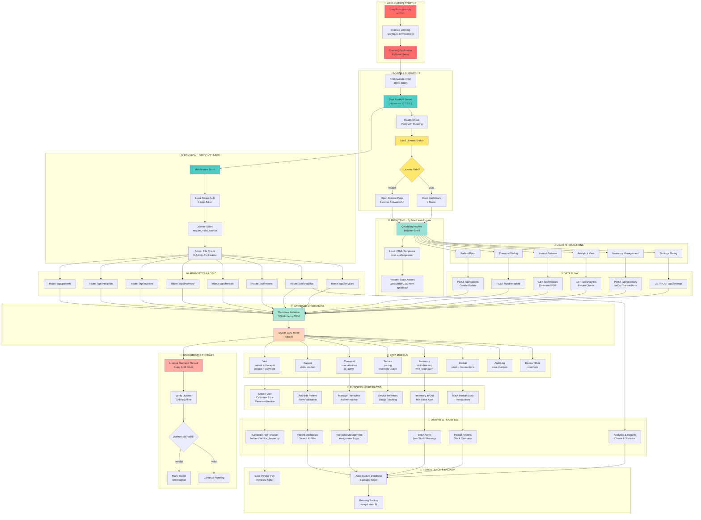
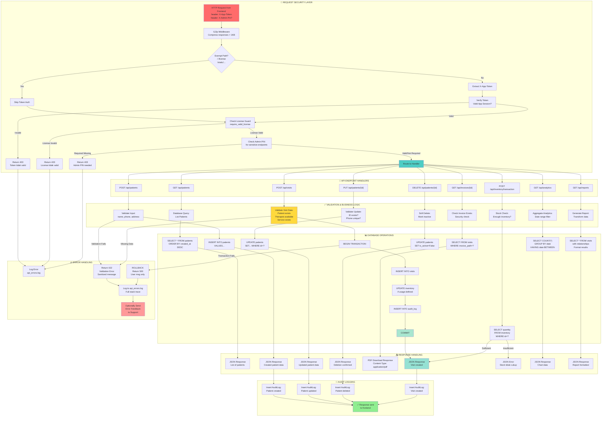

# LancarDinamicAdmin - Architecture & Flowchart Documentation

**Last Updated**: May 16, 2026  
**Project**: LancarDinamicAdmin (Clinic Management System)  
**Stack**: Python + FastAPI + PySide6 + JavaScript/HTML

---

## 📋 TABLE OF CONTENTS

1. [Project Overview](#project-overview)
2. [Main Application Flow](#main-application-flow)
3. [Business Logic Flows](#business-logic-flows)
4. [Database Entity Relationships](#database-entity-relationships)
5. [API Security & Request Processing](#api-security--request-processing)
6. [Architecture Layers](#architecture-layers)
7. [Key Components](#key-components)

---

## 🎯 PROJECT OVERVIEW

| Aspect | Details |
|--------|---------|
| **Type** | Web Desktop Hybrid Application |
| **Purpose** | Medical/Clinic Management System (Bekam/Therapy) |
| **Backend** | FastAPI with Uvicorn |
| **Frontend** | JavaScript/HTML via PySide6 QWebEngineView |
| **Database** | SQLite with WAL Mode |
| **Port Range** | 8000-8020 (auto-detection) |
| **Entry Point** | `main.py` |

---

## 🚀 MAIN APPLICATION FLOW



---

## 📋 BUSINESS LOGIC FLOWS

### Detailed Module Flows:

```mermaid
graph TD
    subgraph "📋 PATIENT MANAGEMENT FLOW"
        P1["User Opens Patient Form"] --> P2["Frontend Request:<br/>POST /api/patients"]
        P2 --> P3["Backend validates<br/>name, phone, address"]
        P3 --> P4{Valid?}
        P4 -->|Yes| P5["Database: Insert Patient<br/>Set created_at timestamp"]
        P4 -->|No| P6["Return Error<br/>Validation Failed"]
        P5 --> P7["Create Visit Record<br/>for patient"]
        P7 --> P8["Refresh Patient List<br/>Search/Filter"]
    end

    subgraph "🏥 VISIT & INVOICE FLOW"
        V1["User Creates Visit"] --> V2["Select Patient<br/>+ Therapist<br/>+ Service"]
        V2 --> V3["Calculate Price<br/>Apply Discounts"]
        V3 --> V4["Check Payment Method<br/>Cash/Gateway"]
        V4 --> V5{Payment<br/>Type?}
        V5 -->|Cash| V6["Mark as Paid<br/>Immediately"]
        V5 -->|Gateway| V7["Create Payment URL<br/>Xendit/Gateway"]
        V6 --> V8["Generate PDF Invoice<br/>invoice_helper.py"]
        V7 --> V8
        V8 --> V9["Save to invoices/<br/>folder"]
        V9 --> V10["Record in Database<br/>Visit.invoice_path"]
        V10 --> V11["Update AuditLog<br/>Track Changes"]
    end

    subgraph "📦 INVENTORY FLOW"
        I1["User Manages Inventory"] --> I2["Choose: Stock In<br/>or Stock Out"]
        I2 --> I3{Transaction<br/>Type?}
        I3 -->|Stock In| I4["Add quantity<br/>to Inventory"]
        I3 -->|Stock Out| I5["Deduct quantity<br/>Check min_stock"]
        I4 --> I6["Create Transaction Log<br/>InventoryTransaction"]
        I5 --> I6
        I6 --> I7{Stock Low?}
        I7 -->|Yes| I8["Alert: Below<br/>Minimum Stock"]
        I7 -->|No| I9["Continue"]
        I8 --> I9
        I9 --> I10["Update last_updated<br/>timestamp"]
        I10 --> I11["Record in AuditLog"]
    end

    subgraph "💊 HERBAL STOCK MANAGEMENT"
        H1["User Manages Herbals"] --> H2["Select Herbal Item"]
        H2 --> H3["View Stock Status<br/>quantity vs min_stock"]
        H3 --> H4["Input Transaction:<br/>quantity + note"]
        H4 --> H5["Calculate New Stock<br/>add or subtract"]
        H5 --> H6["Create HerbalTransaction<br/>Log Change"]
        H6 --> H7["Update Herbal<br/>last_updated"]
        H7 --> H8["Record AuditLog<br/>for compliance"]
    end

    subgraph "👨‍⚕️ THERAPIST MANAGEMENT"
        T1["Open Therapist Dialog"] --> T2["List Active Therapists<br/>from Database"]
        T2 --> T3["User Action:<br/>Add/Edit/Delete"]
        T3 --> T4["Validate Name<br/>Specialization<br/>Gender"]
        T4 --> T5["Save to Database<br/>Update is_active"]
        T5 --> T6["Update Visit Assignments<br/>Check therapist availability"]
        T6 --> T7["Record in AuditLog<br/>Staff Changes"]
    end

    style P1 fill:#FFE5E5
    style V1 fill:#E5F5FF
    style I1 fill:#E5FFE5
    style H1 fill:#FFF5E5
    style T1 fill:#F5E5FF
```



---

## 🗄️ DATABASE ENTITY RELATIONSHIPS

```mermaid
erDiagram
    PATIENTS ||--o{ VISITS : has
    PATIENTS ||--o{ PATIENT_FOLLOWUP : has
    PATIENTS ||--o{ PATIENT_MANUAL_TAG : has
    PATIENTS ||--o{ PATIENT_CONTACT_PREFERENCE : has
    PATIENTS ||--o{ VOUCHER_PATIENT_TARGET : has
    THERAPISTS ||--o{ VISITS : assigned_to
    SERVICES ||--o{ VISITS : "used_in"
    SERVICES ||--o{ SERVICE_INVENTORY_USAGE : uses
    INVENTORY ||--o{ SERVICE_INVENTORY_USAGE : "part_of"
    INVENTORY ||--o{ INVENTORY_TRANSACTION : "tracked_by"
    HERBALS ||--o{ HERBAL_TRANSACTION : "tracked_by"
    DISCOUNT_RULES ||--o{ VISITS : applied_to
    VOUCHER_USAGE ||--o{ VISITS : "redeemed_in"
    VISITS ||--o{ AUDIT_LOG : "changes_logged_in"
    PATIENTS ||--o{ AUDIT_LOG : "changes_logged_in"
    INVENTORY ||--o{ AUDIT_LOG : "changes_logged_in"
    HERBALS ||--o{ AUDIT_LOG : "changes_logged_in"
    CORRECTION_LOG ||--o{ VISITS : "tracks_corrections"

    PATIENTS {
        int id PK
        string name UK
        string phone UK
        string address
        string gender
        datetime created_at
    }

    THERAPISTS {
        int id PK
        string name UK
        string gender
        string specialization
        boolean is_active
        boolean can_handle_any_gender
    }

    SERVICES {
        int id PK
        string name UK
        string unit_label
        int default_quantity
        decimal price_per_unit
        text notes_template
        boolean is_active
    }

    VISITS {
        int id PK
        int patient_id FK
        int therapist_id FK
        int service_id FK
        datetime date
        decimal price
        boolean discount_applied
        int point_count
        string invoice_path
        text medical_notes
        boolean is_free_visit
        string invoice_status
        string payment_status
        string payment_method
    }

    INVENTORY {
        int id PK
        string item_name UK
        int quantity
        string unit
        int package_size
        int min_stock
        boolean is_active
    }

    INVENTORY_TRANSACTION {
        int id PK
        int inventory_id FK
        datetime date
        int change
        string transaction_type
        text note
    }

    HERBALS {
        int id PK
        string name UK
        int quantity
        string unit
        int min_stock
        boolean is_active
    }

    HERBAL_TRANSACTION {
        int id PK
        int herbal_id FK
        datetime date
        int change
        string transaction_type
        text note
    }

    DISCOUNT_RULES {
        int id PK
        string name UK
        string type
        decimal value
        boolean is_active
    }

    VOUCHER_USAGE {
        int id PK
        int visit_id FK
        string voucher_code
        datetime used_at
    }

    VOUCHER_PATIENT_TARGET {
        int id PK
        int patient_id FK
        string voucher_code
    }

    AUDIT_LOG {
        int id PK
        string table_name
        int record_id
        string operation
        datetime timestamp
    }

    CORRECTION_LOG {
        int id PK
        int visit_id FK
        text description
        datetime corrected_at
    }

    PATIENT_FOLLOWUP {
        int id PK
        int patient_id FK
        datetime followup_date
        text notes
    }

    PATIENT_MANUAL_TAG {
        int id PK
        int patient_id FK
        string tag
    }

    PATIENT_CONTACT_PREFERENCE {
        int id PK
        int patient_id FK
        string preference_type
    }

    SERVICE_INVENTORY_USAGE {
        int id PK
        int service_id FK
        int inventory_id FK
        int quantity_per_service
    }
```



---

## 🔐 API SECURITY & REQUEST PROCESSING



---

## 🏗️ ARCHITECTURE LAYERS

### **1. Desktop Shell Layer** (`main.py`)
- Entry point aplikasi
- Menjalankan Uvicorn FastAPI server pada localhost:8000
- Membuat PySide6 QWebEngineView (browser wrapper)
- Menangani verifikasi lisensi
- License background recheck thread (6-12 jam interval)
- Custom SSL certificate handling untuk localhost

**Key Functions:**
- `run_fastapi()` - Memulai server Uvicorn
- `find_available_port()` - Mencari port kosong (8000-8020)
- `health_check()` - Verifikasi API merespon
- `start_license_recheck_thread()` - Background license validation

### **2. Backend API Layer** (`api/main.py`)
FastAPI application dengan:
- **Middleware Stack**:
  - GZip compression (>1000 bytes)
  - Local token authentication (`X-App-Token`)
  - License guard
  - Admin PIN verification
- **Error Handling**: Safe error messages untuk users
- **Logging**: Rotating file handler (`api_errors.log`)

### **3. Database Layer** (`database.py`)
- **ORM**: SQLAlchemy
- **Connection**: SQLite dengan WAL mode
- **Session Management**: Thread-safe connection pool
- **Mixins**: Modular database operations

---

## 🔑 KEY COMPONENTS

### **API Routes** (`api/routes/`)

| Route | Purpose |
|-------|---------|
| `/api/patients` | Patient CRUD operations |
| `/api/therapists` | Therapist management |
| `/api/invoices` | Invoice operations & PDF |
| `/api/inventory` | Stock management |
| `/api/herbals` | Herbal tracking |
| `/api/visits` | Visit records & billing |
| `/api/services` | Service definitions |
| `/api/analytics` | Reports & statistics |
| `/api/payments` | Payment gateway |
| `/api/reports` | Custom reports |
| `/api/settings` | Application settings |
| `/api/crm` | Patient relationship |
| `/api/audit` | Audit log retrieval |

### **Database Models**

**Core Tables:**
- `PATIENTS` - Patient data with contact info
- `THERAPISTS` - Staff members with specialization
- `VISITS` - Visit records (core business entity)
- `SERVICES` - Service definitions with pricing
- `INVENTORY` - Tool/equipment stock tracking
- `HERBALS` - Herbal/medicine stock
- `DISCOUNT_RULES` - Discount/voucher rules
- `AUDIT_LOG` - Change tracking for compliance

**Supporting Tables:**
- `INVENTORY_TRANSACTION` - Stock movement logs
- `HERBAL_TRANSACTION` - Herbal movement logs
- `SERVICE_INVENTORY_USAGE` - Service-inventory mapping
- `VOUCHER_USAGE` - Voucher redemption tracking
- `PATIENT_FOLLOWUP` - Patient follow-up schedule
- `PATIENT_MANUAL_TAG` - Custom patient tags
- `CORRECTION_LOG` - Visit correction history

### **Security Features**

✅ License verification (online + offline cache)  
✅ Local token authentication per session  
✅ Admin PIN untuk aksi sensitif  
✅ Error sanitization (tidak expose teknis detail)  
✅ Audit log untuk compliance  
✅ Transaction management untuk data integrity  

### **Business Features**

📋 Patient management (CRUD + search/filter)  
👨‍⚕️ Therapist management  
💊 Inventory & herbal stock tracking  
🏥 Visit & invoice management  
💰 Payment gateway integration (Xendit)  
📊 Analytics & reports  
📄 PDF invoice generation  
💾 Auto database backup  
🔐 License-based access control  

---

## 📁 PROJECT STRUCTURE

```
LancarDinamicAdmin/
├── main.py                      # Entry point
├── api/
│   ├── main.py                 # FastAPI app
│   ├── admin_pin.py            # PIN verification
│   ├── license_guard.py        # License middleware
│   ├── database_manager.py
│   ├── routes/                 # API endpoints
│   │   ├── patients.py
│   │   ├── therapists.py
│   │   ├── invoices.py
│   │   ├── inventory.py
│   │   ├── herbals.py
│   │   ├── visits.py
│   │   ├── analytics.py
│   │   ├── reports.py
│   │   └── ...
│   ├── templates/              # HTML pages
│   └── static/                 # JS/CSS/assets
├── helpers/
│   ├── license.py              # License verification
│   ├── local_token.py          # Token generation
│   ├── invoice_helper.py       # PDF generation
│   ├── backup_helper.py        # Database backup
│   └── payment_rules.py        # Payment allocation
├── database.py                 # SQLAlchemy setup
├── db_models.py               # ORM models
├── db_dataclasses.py          # DTO models
├── db_mixins_*.py             # Modular DB ops
├── utils/
│   ├── app_paths.py
│   └── styles.py
├── legacy_ui/                 # DEPRECATED
├── backups/                   # Database backups
├── invoices/                  # Generated PDFs
├── logs/                      # Log files
└── docs/                      # Documentation
```

---

## 🔄 BACKGROUND PROCESSES

### **License Recheck Thread**
- Runs every 6-12 hours (random with jitter)
- Verifies license status online
- Exponential backoff on network errors
- Emits signal if license becomes invalid
- File: `helpers/license.py`

### **API Logging**
- Rotating file handler (5MB limit, 5 backups)
- Logs HTTP 5xx errors
- Logs validation issues
- File: `logs/api_errors.log`

---

## ⚡ PERFORMANCE OPTIMIZATIONS

- **Database**: WAL mode for concurrent reads
- **API**: GZip middleware (>1KB responses)
- **Caching**: License cached locally
- **Indexes**: Strategic indexes on frequently queried fields
- **Pool**: Connection pooling with `pool_pre_ping`

---

## 🚨 ERROR HANDLING

| Status | Purpose |
|--------|---------|
| **422** | Validation errors with sanitized message |
| **403** | Token/PIN/License failures |
| **404** | Resource not found |
| **500** | Server error (user-friendly message logged) |

**Strategy:**
- User receives sanitized messages
- Full stack traces logged server-side
- Transaction rollback on failure
- Error feedback system for support

---

## 📊 AUDIT & COMPLIANCE

- Every data change recorded in `AUDIT_LOG`
- Tracks: table_name, record_id, operation, timestamp
- Soft deletes (marking inactive) vs hard deletes
- Correction logs for voided visits
- Payment provider tracking
- Medical notes preserved

---

## 🔗 INTEGRATIONS

| Service | Purpose |
|---------|---------|
| **Xendit** | Payment gateway (supports mock mode) |
| **WhatsApp** | CRM messaging |
| **PDF** | Invoice generation |
| **Excel** | Report export |
| **Backup** | Database snapshots |

---

## 📝 CODE QUALITY

### ✅ **Strengths:**
- Modular architecture (mixins for separation)
- Proper error handling & sanitization
- Audit trail for compliance
- Multi-layer security (token, license, PIN)
- Transaction management for data integrity

### ⚠️ **Areas to Monitor:**
- `database.py` could be split further
- Legacy UI folder still present (not active)
- Multiple payment status fields (could consolidate)

---

**Generated**: May 16, 2026  
**Version**: 1.0
