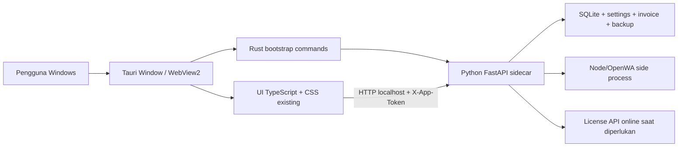

# PRD - Migrasi Desktop LancarDinamicAdmin ke Tauri

> **Versi:** 0.1-draft  
> **Tanggal:** 2026-05-26  
> **Status:** Proposal internal, memerlukan persetujuan sebelum implementasi  
> **Platform target awal:** Windows 10/11 x64  
> **Stack target awal:** Tauri v2 + frontend TypeScript existing + Python/FastAPI sidecar

---

## 1. Ringkasan Eksekutif

LancarDinamicAdmin saat ini adalah aplikasi desktop Windows dengan:

- shell desktop `PySide6`/`QWebEngineView` di `main.py`;
- UI HTML/CSS dengan source TypeScript di `api/static/ts/` yang dikompilasi menjadi JavaScript runtime;
- API lokal `FastAPI`/`Uvicorn`;
- database lokal SQLite dan file runtime pada direktori aplikasi user;
- proses pendukung WhatsApp Gateway berbasis Node.js/OpenWA.

Migrasi ini mengganti **desktop shell PySide6** dengan **Tauri v2**. Migrasi ini **bukan rewrite frontend dari JavaScript ke Tauri**: Tauri tetap merender web frontend, sehingga source TypeScript dan asset UI saat ini harus dipertahankan terlebih dahulu.

Rekomendasi arsitektur adalah migrasi inkremental:

1. Tauri menjadi window lifecycle, installer, capability security, download/open-folder bridge, dan orchestrator proses.
2. Backend Python/FastAPI tetap berjalan sebagai binary sidecar yang dibundel, sehingga domain klinik, SQLite, invoice, backup, lisensi, dan endpoint tidak ditulis ulang pada rilis pertama.
3. PySide6 dihapus setelah parity shell tercapai dan dependensi Qt pada modul backend, khususnya lisensi, telah dipisahkan.
4. Rewrite backend Python ke Rust tidak termasuk MVP dan hanya dipertimbangkan melalui proposal terpisah setelah aplikasi Tauri stabil.

---

## 2. Latar Belakang dan Masalah

### 2.1 Kondisi Saat Ini

| Area | Implementasi saat ini | Konsekuensi migrasi |
|---|---|---|
| Desktop window | `PySide6.QtWebEngineWidgets.QWebEngineView` | Diganti WebView Tauri |
| Startup backend | Thread Python menjalankan Uvicorn di `127.0.0.1`, memilih port kosong | Tauri perlu spawn sidecar, membaca port, dan menunggu health check |
| Navigasi eksternal | `QDesktopServices.openUrl()` | Diganti command/plugin Tauri dengan izin minimum |
| Download export | `QWebEngineProfile.downloadRequested` menyimpan ke Downloads | Harus diverifikasi pada WebView2 atau diganti dialog/save flow Tauri |
| Lisensi | `helpers/license.py` mengimpor `QApplication`/`QMessageBox` | Harus dipisahkan dari Qt sebelum PySide6 dihapus |
| API lokal | FastAPI + header `X-App-Token` | Dipertahankan pada MVP |
| UI | Template server-rendered memuat `/static/*.js` dan asset lokal | Dipertahankan pada MVP untuk menekan risiko |
| Data lokal | SQLite, settings terenkripsi, invoice, backup, log | Harus tetap memakai data user lama tanpa migrasi destruktif |
| WhatsApp | FastAPI mengelola Node/OpenWA dan Node portable dalam build | Dipertahankan; packaging baru wajib membawanya dengan benar |

### 2.2 Masalah yang Ingin Diselesaikan

- Distribusi PySide6/WebEngine membuat paket desktop besar dan menambah permukaan maintenance shell Python.
- Logic desktop, API, dan dialog Qt saling terikat sehingga sulit mengembangkan shell secara independen.
- Konfigurasi WebEngine saat ini mengaktifkan flag permisif seperti `--disable-web-security` dan ignore certificate lokal; shell baru harus memiliki security boundary yang lebih eksplisit.
- Build desktop belum mempunyai pemisahan jelas antara frontend web, backend domain, dan lifecycle aplikasi.

---

## 3. Tujuan

### 3.1 Tujuan Produk

1. Menyediakan aplikasi desktop Windows dengan UX dan fitur operasional setara versi PySide6.
2. Menjaga seluruh data klinik existing dapat dibuka oleh aplikasi Tauri tanpa import manual.
3. Menjaga fungsi offline setelah aktivasi sesuai kebijakan lisensi existing.
4. Mempertahankan modul bisnis stabil selama pergantian desktop shell.

### 3.2 Tujuan Teknis

1. Mengganti `QWebEngineView` dan lifecycle window dengan Tauri v2.
2. Menjalankan FastAPI sebagai sidecar terbundel tanpa kewajiban Python terpasang pada mesin user.
3. Menghapus dependency runtime `PySide6` setelah semua coupling Qt dipindahkan.
4. Menerapkan capabilities Tauri minimum, tanpa akses shell/file system umum dari frontend.
5. Menghasilkan installer Windows yang bersih dari database, settings, invoice, backup, log, dan session WhatsApp developer.

### 3.3 Sasaran Keberhasilan

| Metrik | Target MVP |
|---|---|
| Parity fitur operasional P1 | 100% skenario acceptance P1 lulus |
| Data compatibility | Database/settings existing terbaca tanpa kehilangan data |
| Startup dashboard pada PC uji standar | <= 5 detik p95 setelah aplikasi dibuka |
| Crash startup pada pilot | < 1% sesi |
| Security | Tidak ada WebView flag untuk menonaktifkan web security; capability direview |
| Distribusi | Installer berjalan di Windows bersih yang memenuhi prasyarat WebView2 |

---

## 4. Non-Goal

- Menulis ulang seluruh FastAPI, SQLAlchemy, database, invoice, laporan, atau lisensi dalam Rust pada MVP.
- Mengganti UI menjadi React/Vue/Svelte atau melakukan redesign besar.
- Mengubah skema database bisnis kecuali metadata teknis yang diperlukan untuk kompatibilitas.
- Menambah dukungan macOS/Linux sebelum rilis Windows stabil.
- Mengubah provider payment atau gateway WhatsApp sebagai bagian migrasi shell.
- Menghapus fallback operasional sebelum parity dan rollback teruji.

---

## 5. Pengguna dan User Story

| Peran | User story utama |
|---|---|
| Admin/Kasir | Sebagai kasir, saya membuka aplikasi desktop baru dan tetap dapat mencatat pasien, kunjungan, herbal, serta invoice tanpa belajar ulang alur kerja. |
| Owner | Sebagai owner, saya melihat laporan dan ekspor data yang sama akuratnya setelah migrasi. |
| Support | Sebagai support, saya dapat membaca log, membuat/restore backup, memeriksa lisensi, dan mendiagnosis kegagalan sidecar. |
| Developer/Release | Sebagai developer, saya membangun installer Tauri secara repeatable tanpa membawa data runtime atau dependency Qt. |

---

## 6. Keputusan Arsitektur

### 6.1 Opsi yang Dievaluasi

| Opsi | Deskripsi | Keputusan |
|---|---|---|
| A. Tauri + Python/FastAPI sidecar | Ganti shell, pertahankan API/domain/data | **Dipilih untuk MVP** |
| B. Tauri + rewrite backend Rust sekaligus | UI dan seluruh domain dipindahkan langsung | Ditolak untuk MVP karena blast radius terlalu besar |
| C. Tetap PySide6 | Melanjutkan shell saat ini | Hanya menjadi jalur rollback sementara |

### 6.2 Alasan Memilih Sidecar

- Endpoint dan business rule saat ini sudah tersebar di banyak route FastAPI dan helper Python.
- Fungsi sensitif, termasuk transaksi, laporan, PDF, backup/restore, lisensi, dan WhatsApp, tidak perlu berubah bersamaan dengan shell.
- Tauri v2 secara resmi mendukung external binary/sidecar, termasuk API server Python yang dibundel dengan PyInstaller.
- Perubahan dapat diuji sebagai parity migration, bukan validasi ulang seluruh produk.

### 6.3 Arsitektur Target MVP



### 6.4 Prinsip Pemisahan Tanggung Jawab

| Komponen | Tanggung jawab MVP |
|---|---|
| Tauri/Rust | Launch/stop sidecar, window, deep link eksternal, log bootstrap, capability, packaging, crash message startup |
| Web frontend | Tampilan dan interaksi fitur existing; memanggil API lokal seperti sekarang |
| Python sidecar | Seluruh API/domain logic, validasi, SQLite, report/PDF, lisensi, token lokal, backup, Node gateway orchestration |
| Node/OpenWA | Session dan pengiriman WhatsApp sesuai policy existing |

---

## 7. Scope Fungsional MVP

### 7.1 Shell Desktop

- Window aplikasi dengan ukuran awal setara aplikasi saat ini dan judul klinik setelah konfigurasi terbaca.
- Loading state saat sidecar belum siap.
- Error state yang aman bila sidecar gagal start atau health check timeout.
- Single-instance behavior agar dua instance tidak memperebutkan data/port.
- Tutup aplikasi harus menghentikan sidecar Python dan proses child yang dimiliki aplikasi secara tertib.

### 7.2 API dan Frontend

- Tauri membuka UI existing yang disediakan FastAPI pada localhost pada fase parity.
- Seluruh tab dashboard, pasien, layanan, terapis, herbal, inventori, CRM, invoice, laporan, settings, audit, dan WhatsApp tetap tersedia.
- Header `X-App-Token` dan `X-Admin-Pin` tetap berlaku.
- Build TypeScript/Tailwind existing tetap menjadi sumber asset runtime pada MVP.

### 7.3 Data dan File

- Gunakan direktori data aplikasi existing `%APPDATA%\LancarDinamicAdmin` pada build distribusi.
- Jangan memindahkan atau mereset `data.db`, `settings.json`, invoice, backup, log, atau export saat upgrade.
- Export/download laporan dan invoice tetap dapat dibuka/disimpan dari desktop shell.
- Backup sebelum migrasi disarankan oleh installer/release note; restore tetap melalui flow aplikasi.

### 7.4 Lisensi

- Aktivasi awal, cached verification, offline grace period, invalidation, serta background re-check harus tetap berperilaku sama.
- Dialog Qt di `helpers/license.py` harus diganti dengan hasil status/API event yang bisa ditampilkan UI/Tauri.
- Tidak boleh memasukkan license key, settings user, atau response sensitif ke bundle/log installer.

### 7.5 WhatsApp Gateway

- Node runtime/OpenWA dan dependency yang diperlukan tetap ikut paket distribusi atau disediakan sebagai sidecar/resource yang terkontrol.
- QR login, session existing, queue, opt-out, dan audit status tidak boleh hilang.
- Session development tidak boleh ikut installer.

---

## 8. Kebutuhan Teknis

### 8.1 Struktur Project Target yang Direkomendasikan

```text
/
  api/                       # FastAPI existing
  api/static/ts/             # source frontend existing
  helpers/                   # domain/helper Python existing
  src-tauri/
    src/
      lib.rs                 # bootstrap dan lifecycle
      sidecar.rs             # start/stop/health sidecar
      commands.rs            # command desktop terkontrol
    capabilities/
      default.json
    binaries/
      lancar-api-<target>.exe
    tauri.conf.json
  openwa_server/             # resource runtime existing
  package.json               # build UI + Tauri scripts
```

Nama akhir dan pemecahan file Rust dapat disesuaikan pada technical design, tetapi boundary komponen wajib dipertahankan.

### 8.2 Sidecar Python

- Buat entrypoint backend-only baru, misalnya `sidecar_main.py`, yang menjalankan FastAPI tanpa import Qt.
- Backend memilih port localhost kosong atau menerima port yang ditetapkan bootstrap Tauri.
- Port dan token tidak boleh diekspos ke origin remote yang tidak dipercaya.
- Tauri menunggu `/health` dengan timeout terukur sebelum menavigasi window ke UI.
- Sidecar dibundel menjadi binary tanpa `PySide6`; dependency Python yang masih diperlukan tetap disertakan.
- Shutdown harus menghentikan Uvicorn, Node/OpenWA child bila dimiliki sesi tersebut, dan melepaskan lock instance.

### 8.3 WebView dan Bridge Desktop

- Pada fase parity, UI boleh tetap di-serve melalui `http://127.0.0.1:<port>/` untuk mempertahankan template dan relative endpoint existing.
- Web frontend tidak diberikan izin shell generik. Operasi membuka URL eksternal, folder, atau file harus melalui command sempit yang memvalidasi target.
- Investigasi teknis wajib menentukan bagaimana UI localhost memperoleh command Tauri dengan aman; jika origin localhost tidak diberi IPC, aksi desktop dialirkan melalui endpoint sidecar ke event/command terkontrol.
- Flag Qt lama untuk menonaktifkan web security dan menerima certificate error tidak dibawa ke Tauri.

### 8.4 Capabilities dan Security

- Default capability hanya mengaktifkan API inti yang benar-benar diperlukan.
- Izin spawn/execute hanya untuk nama sidecar yang dibundel dan argumen yang diperbolehkan.
- Jangan memberi frontend kemampuan menjalankan executable arbitrer, membaca seluruh filesystem, atau menjalankan command shell.
- Terapkan CSP yang kompatibel dengan UI setelah inventaris asset/script dilakukan.
- Bind API hanya pada `127.0.0.1`, pertahankan token sesi, sanitasi error, dan jangan membuka CORS luas.
- Semua perubahan security dicatat dalam threat review sebelum pilot.

### 8.5 Build dan Installer Windows

- Development membutuhkan Rust toolchain MSVC, Microsoft C++ Build Tools, Node.js untuk asset frontend, Python build environment untuk sidecar, dan Microsoft Edge WebView2.
- Installer Tauri harus menyertakan atau memastikan WebView2 tersedia sesuai metode bundle yang dipilih.
- Pipeline build menjalankan typecheck/build frontend, test Python, build sidecar bersih, build Tauri, lalu inspeksi isi installer/output.
- Jangan bundle file runtime user atau development: `settings.json`, `data.db`, `*.db-*`, `invoices/`, `backups/`, `logs/`, `exports/`, WhatsApp session, `.env`, atau secret.

### 8.6 Observability dan Support

- Buat log terpisah untuk bootstrap Tauri dan backend sidecar, keduanya di direktori runtime aplikasi.
- Log harus memuat startup duration, port binding failure, sidecar exit code, health timeout, dan versi aplikasi tanpa memuat token/license key/data pasien.
- Halaman error startup menyediakan pesan pengguna dan lokasi log untuk support.

---

## 9. Perubahan Codebase yang Diperlukan

| Area | Perubahan wajib | Fase |
|---|---|---|
| `main.py` | Dipertahankan sementara untuk rollback; tidak menjadi entrypoint Tauri | P1-P4 |
| `helpers/license.py` | Hapus ketergantungan UI Qt; kembalikan status/error terstruktur | P1-P2 |
| Backend entrypoint | Tambahkan launcher sidecar tanpa PySide6 | P1 |
| Frontend API client | Dukung URL/token bootstrap bila port tidak fixed; jaga kontrak endpoint | P1-P2 |
| Open/download support | Pindahkan aksi OS dari Qt ke command Tauri yang dibatasi | P2 |
| `package.json` | Tambah script dev/build Tauri tanpa merusak build asset existing | P1 |
| `src-tauri/` | Tambah konfigurasi, Rust bootstrap, capability, icons, bundling | P1-P3 |
| Build/release docs | Ganti panduan PyInstaller-shell menjadi Tauri + Python sidecar | P3 |
| Tests | Tambah integration/smoke test startup sidecar dan data compatibility | P1-P4 |

---

## 10. Rencana Implementasi

### Fase 0 - Technical Discovery dan Baseline

**Tujuan:** mengunci baseline parity sebelum perubahan shell.

**Pekerjaan:**

- Catat semua flow kritis existing dan hasil test yang lulus.
- Siapkan database dummy anonim beserta skenario migrasi data.
- Ukur ukuran installer, startup time, dan lokasi file runtime versi PySide6.
- Putuskan strategi port/token, WebView navigation, file download, serta ownership proses Node.

**Exit criteria:**

- Test matrix dan baseline tertulis.
- Tidak ada keputusan security/packaging kritis yang belum memiliki proof of concept.

### Fase 1 - Skeleton Tauri dan Python Sidecar

**Tujuan:** Tauri dapat membuka dashboard existing melalui backend-only sidecar.

**Pekerjaan:**

- Tambah project Tauri v2 dan konfigurasi Windows.
- Tambah entrypoint Python sidecar yang bebas Qt.
- Bundle/spawn sidecar, health check, loading/error screen, shutdown.
- Pertahankan endpoint dan asset existing.

**Exit criteria:**

- Aplikasi Tauri membuka dashboard pada database dummy.
- Tidak ada import `PySide6` dalam proses sidecar yang dijalankan Tauri.
- Startup/close berulang tidak meninggalkan proses API.

### Fase 2 - Desktop Parity dan Decoupling Qt

**Tujuan:** semua fungsi shell PySide6 sudah tersedia lewat Tauri atau UI.

**Pekerjaan:**

- Migrasikan status/dialog lisensi dari Qt.
- Implementasikan external link, open folder/file, download/export, dan pesan error.
- Integrasikan Node/OpenWA serta cleanup child process.
- Terapkan single instance dan capability minimal.

**Exit criteria:**

- Tidak ada fitur pengguna yang membutuhkan shell PySide6.
- Seluruh skenario P1 pada Section 12 lulus.
- Security review capability dan local API lulus.

### Fase 3 - Packaging, Upgrade, dan Pilot

**Tujuan:** installer dapat mengganti versi lama secara aman.

**Pekerjaan:**

- Bangun installer Windows signed atau definisikan proses signing sebelum distribusi komersial.
- Uji install baru, upgrade dari build PySide6, uninstall/reinstall tanpa kehilangan data.
- Uji mesin tanpa environment Python/Node developer.
- Pilot terbatas dan kumpulkan crash/startup metrics.

**Exit criteria:**

- Installer tidak membawa data developer.
- Upgrade membuka data existing dan dapat rollback melalui backup.
- Tidak ada bug P1 terbuka pada pilot.

### Fase 4 - Cutover PySide6

**Tujuan:** Tauri menjadi rilis utama.

**Pekerjaan:**

- Hapus `PySide6` dari runtime dependency rilis utama setelah jalur rollback dibekukan.
- Arsipkan build PySide6 terakhir dan dokumentasikan recovery.
- Update PRD utama, `README`, build guide, release checklist, dan support SOP.

**Exit criteria:**

- Distribusi utama hanya menggunakan shell Tauri.
- Semua dokumentasi tidak lagi menyatakan PySide6 sebagai shell aktif.

### Fase Opsional - Evaluasi Backend Rust

Evaluasi rewrite FastAPI/Python ke command/service Rust hanya setelah MVP stabil. Proposal terpisah wajib menunjukkan manfaat terukur, strategi migrasi database, parity laporan/invoice/lisensi, dan biaya pengujian domain.

---

## 11. Milestone dan Deliverable

| Milestone | Deliverable | Estimasi awal |
|---|---|---|
| M0 Baseline | Test matrix, metric build lama, PoC keputusan kritis | 1 minggu |
| M1 Shell PoC | Tauri memulai sidecar dan membuka UI existing | 1-2 minggu |
| M2 Parity | Lisensi, file action, WhatsApp, shutdown, capability | 2-3 minggu |
| M3 Release Candidate | Installer, upgrade test, data compatibility, docs | 1-2 minggu |
| M4 Pilot/Cutover | Pilot report, fix P1/P2, rilis Tauri utama | 2 minggu pilot |

Estimasi ini harus dikalibrasi ulang setelah M0 karena fitur WhatsApp, lisensi, dan packaging binary dapat memperbesar pekerjaan.

---

## 12. Acceptance Criteria

### 12.1 Startup dan Lifecycle

- **Given** aplikasi dipasang di Windows yang didukung tanpa Python terinstall  
  **When** user membuka aplikasi  
  **Then** Tauri menjalankan backend sidecar terbundel dan dashboard dapat digunakan.

- **Given** port default sudah dipakai proses lain  
  **When** aplikasi dibuka  
  **Then** sidecar memilih port aman lain atau startup gagal dengan pesan yang dapat ditindaklanjuti, tanpa membuka API publik.

- **Given** sidecar gagal siap dalam timeout  
  **When** startup berlangsung  
  **Then** user melihat error generik dan log teknis tersedia tanpa kebocoran secret/data pasien.

- **Given** user menutup window utama  
  **When** proses shutdown selesai  
  **Then** tidak ada proses sidecar atau child process milik sesi aplikasi yang tertinggal.

### 12.2 Data dan Feature Parity

- **Given** device memiliki `data.db` dan settings sah dari rilis PySide6  
  **When** aplikasi Tauri pertama kali dibuka  
  **Then** data pasien, kunjungan, stok, invoice, settings, dan lisensi tetap terbaca tanpa reset.

- **Given** admin menjalankan flow pasien, kunjungan, herbal, inventori, invoice, laporan, backup/restore, CRM, atau WhatsApp  
  **When** flow selesai  
  **Then** hasil bisnisnya sama dengan baseline PySide6 dan audit/security guard tetap berlaku.

- **Given** user mengekspor laporan atau membuka invoice  
  **When** browser shell memicu file action  
  **Then** file dapat disimpan/dibuka secara aman melalui behavior Tauri yang terdokumentasi.

### 12.3 Lisensi dan Security

- **Given** lisensi valid cache/offline grace masih berlaku  
  **When** perangkat offline membuka aplikasi  
  **Then** akses tetap mengikuti aturan lisensi existing tanpa dialog Qt.

- **Given** request API lokal tidak memiliki token sesi valid  
  **When** endpoint protected dipanggil  
  **Then** request ditolak seperti versi existing.

- **Given** UI atau input eksternal mencoba menjalankan executable/path di luar allowlist  
  **When** Tauri command dipanggil  
  **Then** command ditolak oleh validasi/capability.

### 12.4 Build dan Release

- **Given** build release dibuat dari workspace bersih  
  **When** installer dan bundle diperiksa  
  **Then** tidak ada runtime data, token, license key, log, invoice, database, export, atau session WhatsApp developer.

- **Given** rilis Tauri diinstall sebagai upgrade  
  **When** user membuka aplikasi dan menjalankan smoke test  
  **Then** database existing dipakai dan backup dapat dibuat sebelum perubahan data berikutnya.

---

## 13. Test Strategy

| Level | Cakupan | Minimal gate |
|---|---|---|
| Python unit/integration | Rule transaksi, security token, PIN, lisensi, settings, backup, API routes | Suite existing lulus dan test sidecar baru ditambah |
| Frontend static/type | Kontrak TypeScript dan asset runtime | `npm run typecheck` dan `npm run build:assets` lulus |
| Rust unit/integration | Sidecar command, allowlist, lifecycle, health/timeout | Test command dan process failure paths lulus |
| Desktop smoke | Startup, navigation, external link, export/invoice, close/reopen | Lulus pada Windows development dan build install |
| Migration test | Install/upgrade dengan copy data anonim dari versi lama | Tanpa kehilangan/ubah data tak terduga |
| Security test | Port local, capability, secret/log inspection, installer content | Tidak ada temuan P1/P2 terbuka |
| Pilot test | Pemakaian klinik terbatas dengan backup | Tidak ada bug P1 sebelum cutover |

### Dataset QA Wajib

- Klinik baru tanpa database/settings.
- Klinik dengan lisensi valid dan data transaksi/invoice existing.
- Database dengan backup/restore dan export.
- WhatsApp belum login dan sudah memiliki session dummy/test.
- Kasus lisensi offline, invalid, dan kegagalan network.

---

## 14. Risiko dan Mitigasi

| Risiko | Dampak | Prioritas | Mitigasi |
|---|---|---|---|
| Rewrite sekaligus merusak domain transaksi/laporan | Kehilangan kepercayaan/data salah | P1 | Tahan backend Python sebagai sidecar pada MVP |
| `helpers/license.py` tetap tergantung Qt | Sidecar gagal bebas PySide6 | P1 | Pisahkan UI notification dari license service sebelum cutover |
| Sidecar atau Node process tertinggal | Lock data/port, session ganda | P1 | Ownership PID, graceful shutdown, kill-on-exit terkontrol, test reopen |
| Data path berubah saat upgrade | Data terlihat hilang | P1 | Pertahankan `%APPDATA%\LancarDinamicAdmin`, uji upgrade dengan data anonim |
| Capability terlalu longgar | Eksekusi/file access tidak aman | P1 | Allowlist command dan review capability sebelum pilot |
| Localhost API dapat diakses proses/browser lain | Operasi ilegal pada data | P1 | Bind loopback, token sesi kuat, no broad CORS, review token bootstrap |
| Download/open-file berbeda pada WebView2 | Flow laporan/invoice rusak | P2 | PoC fase 0 dan bridge Tauri terkontrol |
| Packaging Python + Node + Tauri kompleks | Installer gagal/ukuran besar | P2 | Build pipeline reproducible, clean-machine test, ukur size pada M0/M3 |
| Antivirus/code signing pada binary gabungan | Instalasi diblokir | P2 | Rencana signing dan uji distribusi pilot |
| Dokumen PRD existing bertentangan | Implementasi tidak konsisten | P2 | Setelah approval, update PRD utama dan release docs sebagai keputusan resmi |

---

## 15. Open Questions yang Harus Diputuskan di Fase 0

| Pertanyaan | Keputusan yang dibutuhkan |
|---|---|
| UI tetap dilayani FastAPI atau dibundle sebagai asset Tauri setelah parity? | MVP memakai FastAPI; evaluasi asset bundle sesudah parity |
| Siapa yang memilih port dan menyalurkan token sesi? | Technical design harus menetapkan handshake tanpa menurunkan security |
| Apakah plugin Tauri dibutuhkan untuk dialog, opener, filesystem, updater, dan single-instance? | Pilih hanya plugin yang lolos allowlist/capability review |
| Format installer target: NSIS, MSI, atau keduanya? | Tentukan berdasarkan deployment dan signing |
| Bagaimana upgrade dari installer Inno/PyInstaller existing ke Tauri? | Uji side-by-side vs in-place serta uninstall behavior |
| Bagaimana ownership proses Node/OpenWA saat sidecar berhenti abnormal? | Tetapkan process supervision dan recovery session |
| Apakah auto-update masuk rilis pertama? | Default: tidak sampai signing dan rollback siap |

---

## 16. Definition of Done Migrasi

Migrasi dianggap selesai ketika:

1. Rilis Windows utama menggunakan Tauri v2 sebagai shell desktop.
2. Semua alur P1 existing dan acceptance criteria migrasi telah lulus.
3. Aplikasi membuka data produksi existing melalui upgrade yang teruji dan memiliki jalur backup/rollback.
4. Runtime release tidak lagi membutuhkan `PySide6` atau Qt WebEngine.
5. Capability, sidecar, token localhost, installer content, logging, dan proses child telah lolos review security.
6. Dokumentasi produk/build/release/support telah diperbarui dan tidak bertentangan.
7. Tidak ada bug P1 terbuka setelah pilot yang disepakati.

---

## 17. Referensi Teknis

Referensi resmi yang diverifikasi pada **2026-05-26**:

- Tauri v2, prerequisites Windows dan WebView2: <https://v2.tauri.app/start/prerequisites/>
- Tauri v2, embedding external binaries/sidecars: <https://v2.tauri.app/develop/sidecar/>
- Tauri v2, capabilities dan permission boundaries: <https://v2.tauri.app/security/capabilities/>
- Tauri v2, webview versions: <https://v2.tauri.app/reference/webview-versions/>

Referensi internal repo:

- `README.md` - fitur aplikasi, stack, runtime data, dan smoke-test existing.
- `docs/PRD.md` - domain produk, acceptance criteria existing, serta status TypeScript.
- `main.py` - implementasi shell PySide6, FastAPI startup, download, external navigation, dan license re-check.
- `BUILD_EXE.md` - packaging PyInstaller, Node/OpenWA, dan aturan exclusion data runtime.
- `helpers/license.py` - coupling Qt yang harus dipisahkan.

---

## 18. Approval Gate

Dokumen ini mengusulkan perubahan terhadap keputusan pada `docs/PRD.md` yang saat ini menyatakan agar framework PySide6 tidak diganti. Implementasi migrasi tidak boleh dianggap keputusan produk final sampai owner/developer menyetujui:

1. arsitektur Tauri + Python sidecar sebagai target MVP;
2. target platform Windows dan strategi installer/upgrade;
3. acceptance criteria data compatibility, lisensi, WhatsApp, dan security;
4. alokasi waktu untuk PoC, pilot, serta rollback.

