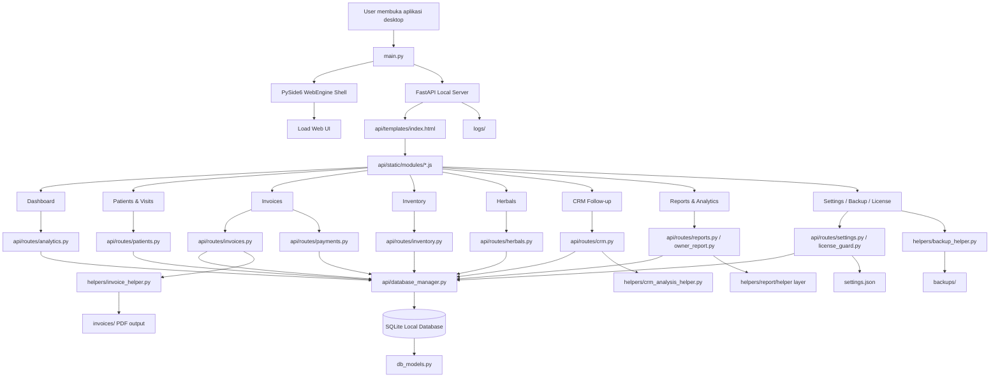

# Flowchart 01 — Project Overview

## Scope

Gambaran besar arsitektur aktif LancarDinamicAdmin.

## Logic Notes

- App berjalan lokal, bukan cloud SaaS.
- Backend FastAPI menjadi pusat API.
- Web UI modular berada di `api/static/modules/`.
- Database utama adalah SQLite lokal via SQLAlchemy models.
- Output runtime utama: PDF invoice, backup database, settings, logs.
