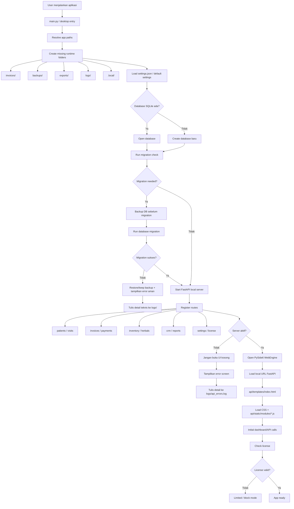

# Flowchart 02 — Startup Desktop & Server

## Scope

Alur aplikasi saat dibuka dari desktop shell PySide6 WebEngine sampai FastAPI local server, database, license, dan UI siap dipakai.

## Logic Notes

- Desktop shell PySide6 WebEngine hanya container UI; logic utama tetap di FastAPI local server.
- UI web modular aktif berada di `api/static/modules/*.js` hasil build dari TypeScript.
- Runtime output berada di `invoices/`, `backups/`, `exports/`, `logs/`, dan `.local/`.
- Migration harus didahului backup agar database aktif bisa dipulihkan jika migration gagal.
- Jika server gagal start, WebEngine tidak boleh dibuka kosong; tampilkan error screen/log yang aman untuk user.
- Jika license tidak valid, aplikasi masuk limited/block mode sesuai rule fitur.
- Operasi sensitif tetap perlu license guard dan/atau admin PIN walaupun aplikasi sudah ready.
