# Flowchart 03 — Pasien & Kunjungan

## Scope

Logic pasien, kunjungan, layanan, terapis, harga, diskon, payment status, stok layanan, dan herbal terkait kunjungan.

```mermaid
flowchart TD
    A[Admin buka menu Pasien] --> B[api/static/modules/patients.js]
    B --> C[GET /patients]
    C --> D[(patients table)]

    B --> E[Tambah / Edit Pasien]
    E --> F{Validasi form}
    F -->|Gagal| G[Tampilkan error aman]
    F -->|Valid| H[POST/PUT pasien]
    H --> I[Tulis audit log]
    I --> D

    B --> J[Tambah Kunjungan]
    J --> K[Admin pilih pasien]
    K --> L[Pilih layanan]
    L --> M[Pilih terapis]
    M --> N[Input quantity / point]
    N --> O[Hitung harga normal]
    O --> P[Cek diskon / voucher]
    P --> Q{Eligible?}
    Q -->|Ya| R[Hitung discount_amount]
    Q -->|Tidak| S[Gunakan harga normal]
    R --> T[Hitung final_price]
    S --> T

    T --> U[Pilih payment_status]
    U --> V[Validasi via helpers/payment_rules.py]
    V --> W{Payment valid?}
    W -->|Tidak| X[Tolak simpan + pesan aman]
    W -->|Ya| Y[Begin DB transaction]

    Y --> Z[Simpan Visit sebagai transaksi utama]
    Z --> AA{Layanan memakai alat?}
    AA -->|Ya| AB[Cek stok inventory]
    AB --> AC{Stok cukup?}
    AC -->|Tidak| ROLLBACK[Rollback semua perubahan]
    AC -->|Ya| AD[Kurangi inventory]
    AD --> AE[Catat inventory_transactions dengan visit_id jika ada]
    AA -->|Tidak| AF[Lanjut]
    AE --> AF

    AF --> AG{Ada herbal terkait kunjungan?}
    AG -->|Ya| AH[Cek stok herbal]
    AH --> AI{Stok cukup?}
    AI -->|Tidak| ROLLBACK
    AI -->|Ya| AJ[Kurangi stok herbal]
    AJ --> AK[Catat herbal_transactions dengan visit_id]
    AG -->|Tidak| AL[Lanjut]
    AK --> AL

    AL --> AM[Catat VoucherUsage jika voucher dipakai]
    AM --> AN[Commit transaction]
    AN --> AO[Tulis audit log visit_created]
    AO --> AP[Invoice tab dapat menampilkan transaksi]

    AP --> PG{payment_method gateway?}
    PG -->|Tidak| END[Flow selesai]
    PG -->|Ya| PG1[Set payment_status pending]
    PG1 --> PG2[Gunakan provider aktif dari Settings]
    PG2 --> PG3[Create payment link / QRIS provider]
    PG3 --> PG4[Simpan payment_reference + payment_url ke Visit]
    PG4 --> PG5[Pasien bayar via link/QR]
    PG5 --> PG6[Status gateway mengubah payment_status]

    ROLLBACK --> AQ[Return error 400/409]
    AQ --> AR[Stok dan visit tetap seperti sebelum proses]
```

## Logic Notes

- `Visit` adalah transaksi utama untuk layanan.
- Herbal yang dijual bersama kunjungan wajib tersambung ke `herbal_transactions.visit_id`.
- Pengurangan stok alat dan herbal harus berada dalam atomic database transaction yang sama dengan penyimpanan visit.
- Jangan sampai visit tersimpan tetapi inventory/herbal gagal dikurangi atau gagal dicatat.
- Jika error di tengah proses, rollback semua perubahan: visit, inventory_transactions, herbal_transactions, voucher usage, dan stok.
- Invoice PDF tidak otomatis wajib dibuat saat visit disimpan; invoice dibuat atau di-refresh dari tab invoice.
- Payment gateway menempel ke transaksi `Visit`, bukan ke file PDF invoice.
- Jika admin memilih metode gateway saat catat kunjungan, provider seharusnya otomatis mengikuti Settings, misalnya Midtrans, lalu sistem membuat `payment_reference` dan `payment_url`.
- Tab invoice menampilkan transaksi dan link pembayaran; PDF invoice hanya snapshot dokumen.
- Audit log wajib mencatat tambah/edit/hapus pasien dan kunjungan.
