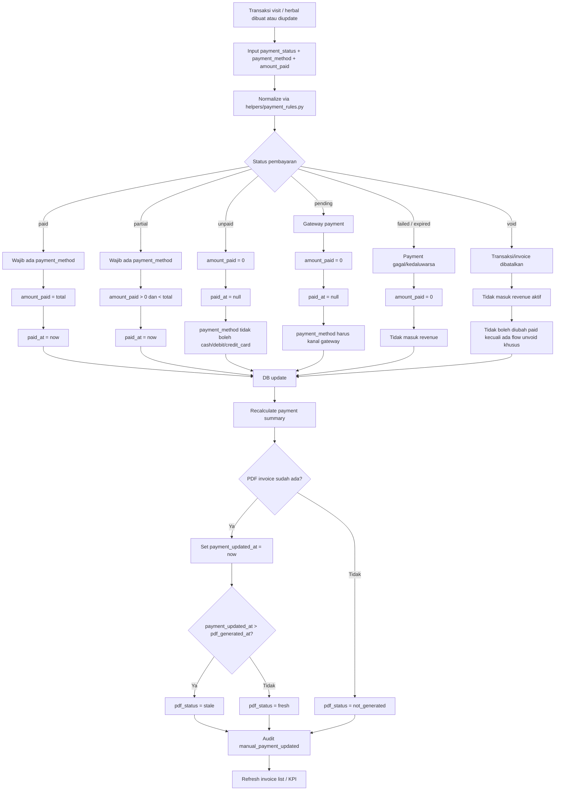

# Flowchart 04 — Payment Status

## Scope

Logic status pembayaran manual dan gateway. Sumber aturan utama adalah `helpers/payment_rules.py`.

## Logic Notes

- `helpers/payment_rules.py` adalah sumber aturan status pembayaran.
- `paid`: wajib ada `payment_method`, `amount_paid = total`, `paid_at = now`.
- `partial`: wajib ada `payment_method`, `amount_paid > 0` dan `< total`, `paid_at = now`.
- `unpaid`: `amount_paid = 0`, `paid_at = null`, metode tidak boleh `cash`, `debit`, atau `credit_card`.
- `pending`: hanya untuk gateway payment, `amount_paid = 0`, `paid_at = null`, metode harus kanal gateway.
- `failed` / `expired`: `amount_paid = 0` dan tidak masuk revenue.
- `void`: tidak masuk revenue aktif dan tidak boleh diubah kembali menjadi paid tanpa flow unvoid khusus.
- Jika `payment_updated_at > pdf_generated_at`, PDF invoice dianggap `stale` dan perlu update.
- Perubahan payment status bukan transaksi baru; ia hanya mengubah status pembayaran transaksi yang sudah ada.
