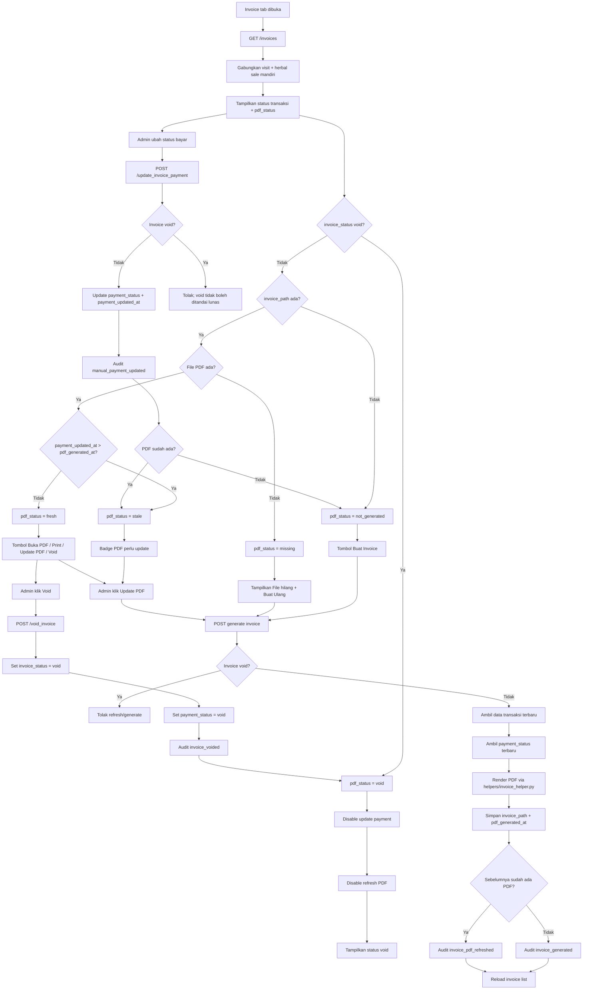

# Flowchart 05 — Invoice & Refresh PDF

## Scope

Logic generate invoice, permanensi transaksi, status PDF, void invoice, dan refresh PDF setelah status pembayaran berubah.

## Metadata Invoice

- `invoice_path`
- `pdf_generated_at`
- `payment_updated_at`
- `invoice_status`
- `payment_status`

## Status PDF

- `fresh`: PDF sesuai data terbaru.
- `stale`: data transaksi/payment berubah setelah PDF dibuat.
- `missing`: `invoice_path` ada tetapi file PDF hilang.
- `not_generated`: belum pernah generate PDF.
- `void`: invoice/transaksi void.

## Logic Notes

- Invoice record/transaksi tidak dibuat dua kali.
- PDF invoice hanyalah snapshot dari transaksi pada waktu tertentu.
- Nomor invoice harus stabil; refresh PDF bukan invoice baru.
- Void invoice tidak boleh di-refresh dan tidak boleh ditandai lunas.
- Jika `payment_updated_at > pdf_generated_at`, PDF perlu update.
- Audit penting: `invoice_generated`, `invoice_pdf_refreshed`, `invoice_voided`, `manual_payment_updated`.
