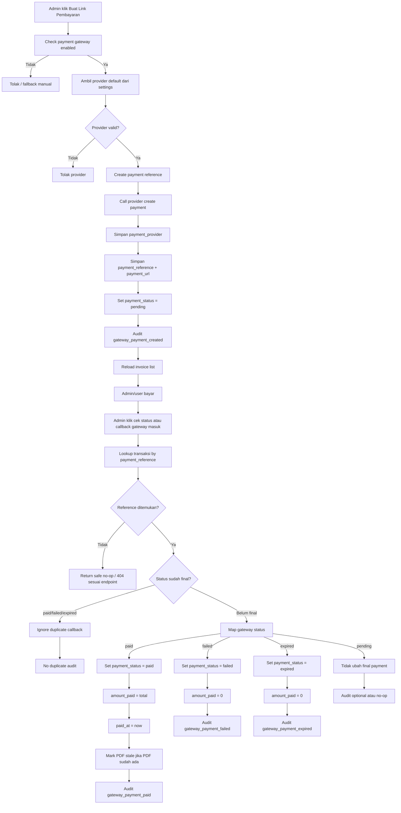

# Flowchart 06 — Payment Gateway

## Scope

Logic pembuatan link pembayaran, pengecekan status gateway, callback idempotent, dan stale PDF setelah status berubah.

## Logic Notes

- Gateway tidak membuat transaksi baru.
- Gateway hanya mengubah status pembayaran transaksi yang sudah ada.
- Callback/status check gateway harus idempotent agar status dan audit tidak dobel.
- Status final: `paid`, `failed`, `expired`.
- Jika transaksi sudah final, duplicate callback harus diabaikan.
- Jika gateway menjadi `paid`, PDF invoice yang sudah ada harus ditandai stale/perlu refresh.
- Provider aktif dan kredensialnya diambil dari settings.
