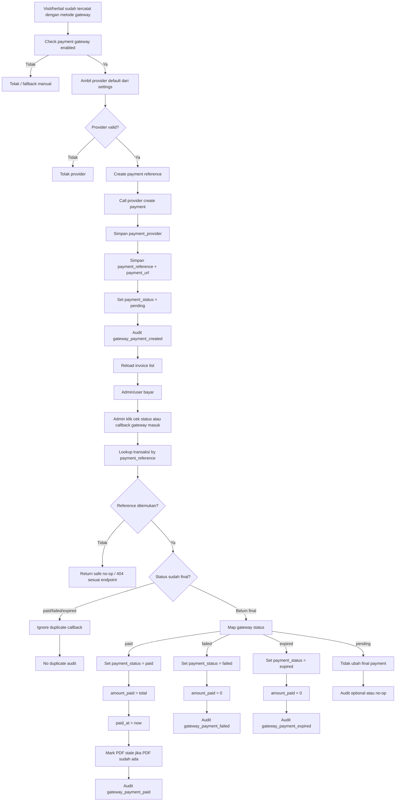
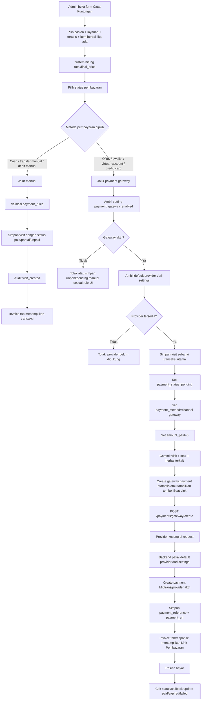
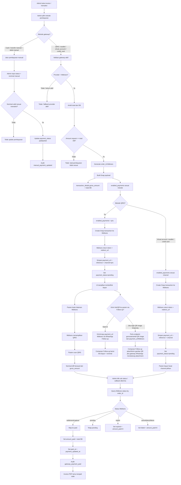

# Flowchart 06 — Payment Gateway

## Scope

Logic pembuatan payment gateway dari pencatatan transaksi/keterangan pembayaran, pengecekan status gateway, callback idempotent, dan stale PDF setelah status berubah.

Gateway tersambung ke **transaksi visit/herbal**, bukan ke file PDF invoice. Tab invoice hanya menjadi layar operasional untuk melihat transaksi, membuat/membuka link pembayaran, refresh PDF, dan cek status.

## Logic Notes

- Gateway tidak membuat transaksi baru.
- Gateway hanya mengubah status pembayaran transaksi yang sudah ada.
- Callback/status check gateway harus idempotent agar status dan audit tidak dobel.
- Status final: `paid`, `failed`, `expired`.
- Jika transaksi sudah final, duplicate callback harus diabaikan.
- Jika gateway menjadi `paid`, PDF invoice yang sudah ada harus ditandai stale/perlu refresh.
- Provider aktif dan kredensialnya diambil dari settings.

---

## Flowchart Saat Catat Kunjungan Memilih Metode Gateway

## Catatan Alur Kunjungan vs Invoice

- Saat catat kunjungan, admin memang memilih `payment_status`, `payment_method`, dan nominal pembayaran jika manual.
- Jika metode yang dipilih adalah kanal gateway (`qris`, `ewallet`, `virtual_account`, `credit_card`), status yang benar adalah `pending` sampai gateway mengonfirmasi.
- Provider seperti Midtrans tidak perlu dipilih di form kunjungan. Provider diambil otomatis dari Settings: `payment_gateway_default_provider`.
- Invoice bukan sumber transaksi. Invoice tab membaca data visit/herbal yang sudah tercatat.
- Payment gateway menempel ke record `Visit` atau `HerbalTransaction` melalui:
  - `payment_provider`
  - `payment_reference`
  - `payment_url`
  - `payment_channel`
  - `payment_gateway_status`
- PDF invoice hanya snapshot. Jika status payment berubah setelah PDF dibuat, PDF menjadi `stale` dan perlu refresh.

## Target UX yang Disarankan

Jika admin memilih metode gateway saat catat kunjungan:

1. Sistem simpan kunjungan sebagai `pending`.
2. Sistem otomatis pakai provider aktif dari Settings, misalnya `midtrans`.
3. Sistem langsung membuat payment link Midtrans.
4. Setelah sukses, UI menampilkan:
    - tombol buka link pembayaran;
    - tombol copy/kirim link ke WhatsApp Follow-up;
    - status `Menunggu pembayaran`.
5. Jika create gateway gagal, visit tidak boleh dianggap lunas. Opsi aman:
    - rollback seluruh pencatatan; atau
    - simpan visit `unpaid/pending_without_link` dengan error jelas dan tombol retry create link.

Implementasi saat ini masih dominan membuat link dari tab invoice melalui tombol **Buat Link Pembayaran**. Target flow lanjutan adalah membuat link otomatis setelah catat kunjungan jika metode gateway dipilih.

---

## Flowchart Midtrans — QRIS, Payment Link, Konfirmasi Nominal, dan WhatsApp Follow-up

## Jawaban Rule Midtrans

### 1. Jika pilih QRIS, apakah menampilkan QR code yang di-scan pasien dengan nominal sesuai?

Ya, target flow Midtrans QRIS adalah:

1. Sistem mengambil nominal dari DB, bukan dari input bebas UI.
2. Sistem menolak request jika `amount` dari UI tidak sama dengan total transaksi DB.
3. Backend membuat transaksi Snap Midtrans dengan:
    - `transaction_details.order_id = payment_reference`
    - `transaction_details.gross_amount = total transaksi DB`
    - `enabled_payments = ["qris"]`
4. Pasien membuka `payment_url` Midtrans.
5. QRIS ditampilkan oleh halaman Midtrans/Snap.
6. Nominal QRIS mengikuti `gross_amount`, sehingga harus sama dengan nominal invoice/transaksi.

Catatan implementasi saat ini: aplikasi menyimpan `payment_url` Snap. QR image langsung belum disimpan sebagai file/attachment lokal. Jadi yang paling aman dikirim ke pasien saat ini adalah link pembayaran Midtrans, bukan gambar QR mentah.

### 2. Jika pilih pembayaran lain, apakah sukses terkonfirmasi nominal harganya?

Ya, untuk channel gateway seperti `virtual_account`, `ewallet`, dan `credit_card`, flow nominal tetap sama:

- total diambil dari DB;
- request ditolak jika nominal tidak cocok;
- Midtrans menerima `gross_amount` sesuai total;
- saat status Midtrans menjadi `settlement` atau `capture`, sistem mengubah status menjadi `paid` dan mengisi `amount_paid = total DB`.

Untuk pembayaran manual seperti `cash` atau transfer manual, tidak lewat Midtrans. Konfirmasi dilakukan lewat update manual dengan validasi payment rule aplikasi.

### 3. Saat QR code muncul, apakah bisa dikirim langsung ke pasien lewat WhatsApp Gateway tab Follow-up?

Ada dua level:

1. **Aman untuk sekarang:** kirim `payment_url` Midtrans lewat WhatsApp Follow-up. Pasien klik link, lalu melihat QRIS/VA/ewallet di halaman Midtrans.
2. **Jika wajib kirim QR image langsung:** perlu tambahan fitur khusus:
    - backend mengambil/generate QR image dari transaksi Midtrans;
    - simpan QR image sementara dengan expiry;
    - composer Follow-up mendukung attachment gambar;
    - WhatsApp gateway/Puppeteer mendukung kirim media, bukan hanya teks;
    - guardrail tetap aktif: consent/preference pasien, send-lock, satu klik satu pasien, audit log.

Rekomendasi rilis aman: kirim link bayar + nominal lewat Follow-up terlebih dahulu. Kirim QR image langsung dibuat sebagai fase lanjutan setelah attachment WhatsApp gateway stabil.

## Acceptance Criteria Midtrans Gateway

- QRIS request wajib memakai `enabled_payments = ["qris"]`.
- `gross_amount` wajib sama dengan total invoice/transaksi DB.
- Request gateway ditolak jika amount dari UI berbeda dari total DB.
- Payment status awal setelah create gateway adalah `pending`.
- Status `settlement`/`capture` dari Midtrans menjadi `paid`.
- Saat `paid`, `amount_paid` harus sama dengan total DB.
- Callback/status check duplicate untuk status final tidak boleh membuat audit/payment dobel.
- Follow-up WhatsApp minimal bisa mengirim teks berisi link bayar, nominal, dan instruksi pembayaran.
- Kirim QR image langsung hanya boleh aktif jika fitur attachment sudah ada dan sudah diuji.
