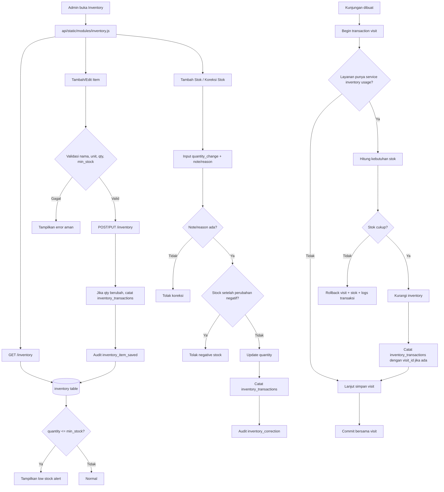

# Flowchart 07 — Inventory Alat

## Scope

Logic stok alat, transaksi inventory, minimum stock, koreksi stok, dan pemakaian stok oleh layanan.

## Logic Notes

- Inventory alat berbeda dari herbal/produk jual.
- Setiap perubahan stok harus punya `inventory_transactions`.
- Koreksi stok wajib punya note/reason.
- Negative stock harus ditolak.
- Pemakaian stok oleh layanan harus terkait `visit_id` jika tersedia.
- Jika visit gagal disimpan, pengurangan stok alat harus rollback.
- Low stock alert muncul saat `quantity <= min_stock`.
