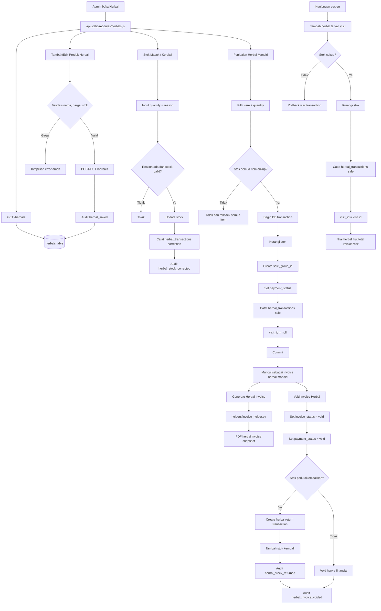

# Flowchart 08 — Produk / Herbal

## Scope

Logic stok herbal, penjualan herbal mandiri, herbal terkait kunjungan, invoice herbal, retur, koreksi, dan void.

## Logic Notes

- Herbal mandiri: `visit_id = null`, punya `sale_group_id`, dan muncul sebagai invoice herbal mandiri.
- Herbal terkait kunjungan: `visit_id = visit.id` dan ikut total invoice visit.
- Void invoice herbal tidak otomatis selalu retur stok.
- Jika salah input, stok biasanya perlu kembali.
- Jika barang sudah dibawa pasien, stok tidak balik walaupun invoice void secara finansial.
- Jika barang rusak/expired, stok tidak balik dan perlu koreksi stok terpisah.
- Status pembayaran herbal bisa berubah; PDF perlu refresh jika sudah dibuat dan data berubah.
- Audit penting: `herbal_invoice_voided`, `herbal_stock_returned`, `herbal_stock_corrected`.
