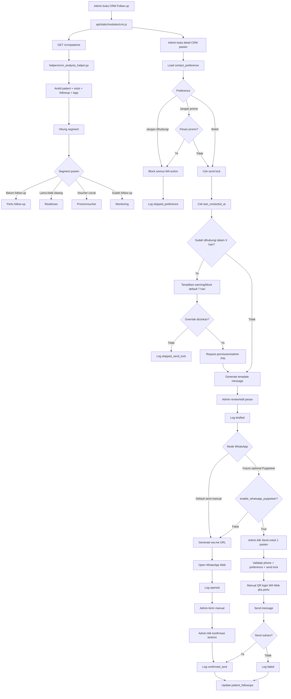

# Flowchart 09 — CRM Follow-up WhatsApp

## Scope

Logic CRM follow-up, segmentasi pasien, contact preference, send lock, pesan WhatsApp semi-manual, dan audit log WA.

## Status Log

- `drafted`
- `opened`
- `confirmed_sent`
- `failed`
- `skipped_preference`
- `skipped_send_lock`

## Logic Notes

- Default mode tetap semi-manual.
- Tidak ada bulk blasting.
- Tidak ada auto-send background.
- Tidak bypass QR WhatsApp.
- Admin tetap review/edit pesan sebelum kirim.
- Contact preference harus dihormati.
- Jika `contact_preference = jangan dihubungi`, semua WA action diblokir.
- Jika `contact_preference = jangan promo`, pesan promo diblokir tetapi pesan non-promo seperti follow-up kesehatan boleh lanjut.
- Send lock default misalnya 7 hari dari `last_contacted_at`.
- Override send lock hanya boleh jika ada permission/admin PIN, bila fitur override disediakan.
- Semua action harus masuk `crm_whatsapp_logs`.
