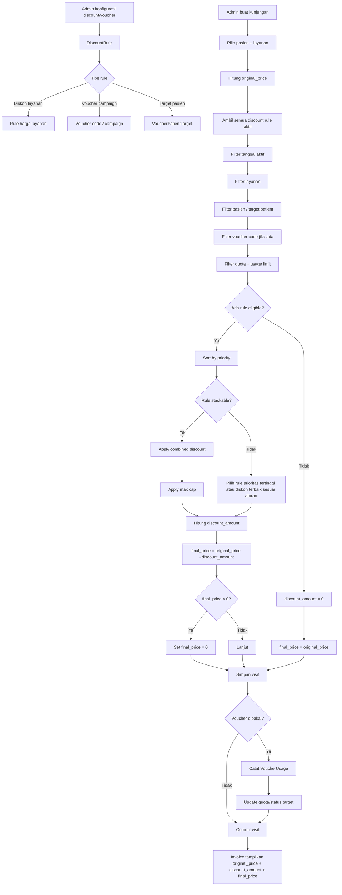

# Flowchart 10 — Voucher / Discount Rule

## Scope

Logic diskon layanan, voucher campaign, voucher targeted patient, priority, stackable rule, quota, dan penggunaan voucher.

## Logic Notes

- Diskon mempengaruhi `final_price`, bukan menghapus `original_price`.
- `final_price` tidak boleh negatif.
- Voucher usage wajib dicatat agar voucher tidak dobel pakai.
- Target patient voucher harus dicek sebelum voucher dianggap eligible.
- Rule priority menentukan urutan evaluasi.
- Stackable discount harus punya max cap agar diskon gabungan tidak berlebihan.
- Invoice harus menampilkan `original_price`, `discount_amount`, dan `final_price`.
