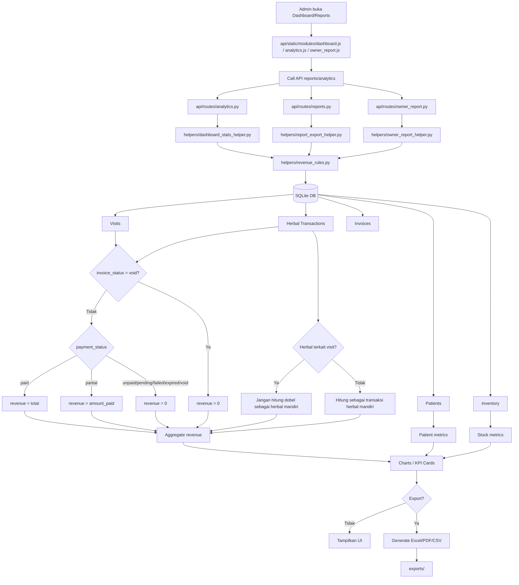

# Flowchart 11 — Reports / Analytics / Owner Report

## Scope

Logic dashboard, analytics, report export, Excel export, KPI cards, owner report, revenue rules, dan pencegahan double count.

## Rekomendasi Helper

`helpers/revenue_rules.py` sebagai single source of truth revenue:

- `invoice_status = void` => revenue `0`.
- `payment_status = paid` => revenue `total`.
- `payment_status = partial` => revenue `amount_paid`.
- `payment_status = unpaid/pending/failed/expired/void` => revenue `0`.

Helper ini harus dipakai oleh:

- dashboard
- analytics
- owner_report
- report export
- Excel export
- KPI cards

## Logic Notes

- Semua angka revenue harus memakai helper/rule yang sama.
- Herbal terkait visit jangan dihitung dobel sebagai herbal mandiri.
- Herbal mandiri dihitung sebagai transaksi sendiri.
- Visit invoice total boleh mencakup layanan + herbal terkait visit.
- Owner report dan dashboard harus memakai rule yang sama agar angka tidak berbeda.
- Void invoice tidak masuk revenue.
