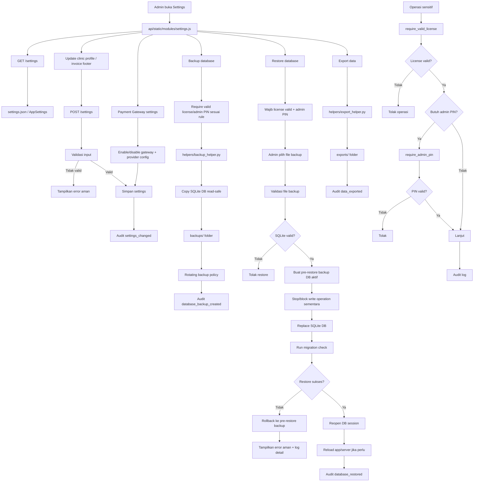

# Flowchart 12 — Settings / Backup / License

## Scope

Logic pengaturan aplikasi, backup database, restore database, export data, dan license/admin PIN guard.

## Logic Notes

- Settings mempengaruhi profil klinik, invoice footer, dan payment gateway.
- Backup database tidak boleh merusak database aktif.
- Restore lebih berisiko daripada backup, sehingga wajib admin PIN dan license valid.
- Export data berbeda dari backup database: export untuk laporan/portable data, backup untuk pemulihan DB penuh.
- Saat restore, write operation harus diblok sementara agar tidak ada transaksi masuk ketika file DB diganti.
- Jika restore gagal, rollback ke pre-restore backup.
- Operasi sensitif seperti void invoice, update payment manual, restore DB, dan license event perlu license guard dan/atau admin PIN.
