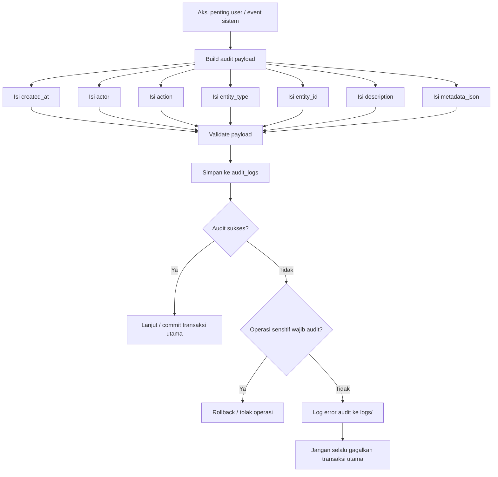

# Flowchart 13 — Audit Log Global

## Scope

Flow global pencatatan audit untuk aksi penting user dan event sistem.

## Aksi yang Wajib Dipertimbangkan untuk Audit

- pasien tambah/edit/hapus
- kunjungan tambah/edit/hapus
- invoice generate/refresh/void
- payment update
- inventory correction
- herbal sale/return/correction
- voucher usage
- CRM WhatsApp log
- backup/restore
- settings change
- license event

## Logic Notes

- Audit log harus berisi konteks cukup untuk debugging dan accountability.
- `metadata_json` harus aman: jangan simpan PIN, token gateway rahasia, password, atau secret lain.
- Untuk operasi sensitif seperti restore DB, void invoice, dan license event, kegagalan audit boleh menggagalkan transaksi.
- Untuk operasi non-sensitif, kegagalan audit cukup ditulis ke log teknis agar transaksi utama tidak selalu gagal.
- Audit harus idempotent untuk callback gateway agar event duplicate tidak membuat audit dobel.
