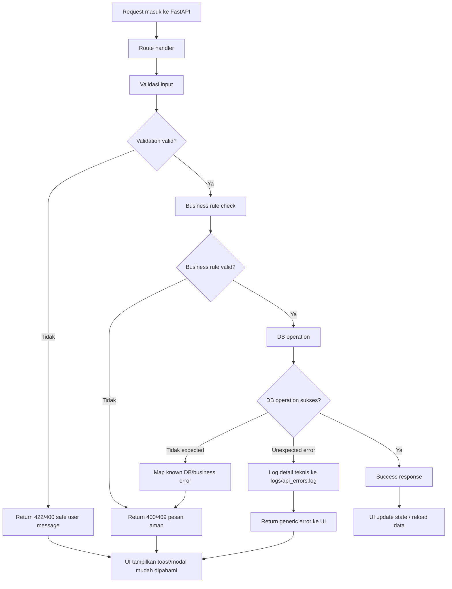

# Flowchart 14 — Error Handling Global

## Scope

Flow global penanganan error dari request FastAPI sampai pesan error tampil di UI.

## Logic Notes

- Pesan untuk user harus aman dan mudah dipahami.
- Detail teknis seperti traceback, SQL, path internal, token, atau secret hanya boleh masuk log teknis.
- Business rule error memakai status seperti 400 atau 409 sesuai konteks.
- Validation error tidak boleh menjalankan DB write.
- Unexpected error harus dicatat ke `logs/api_errors.log` atau log error terstruktur lain.
- UI sebaiknya menampilkan toast/modal dengan aksi yang jelas: ulangi, cek input, atau hubungi support.
