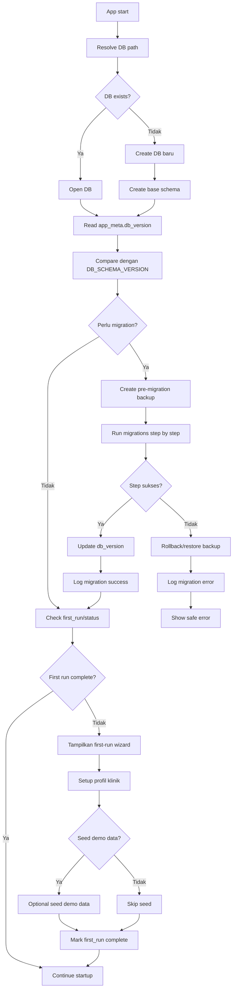

# Flowchart 15 — Database Migration & First Run

## Scope

Flow database first run, schema version, migration, backup pre-migration, dan wizard awal aplikasi.

## Logic Notes

- Migration harus step-by-step dan idempotent jika memungkinkan.
- Pre-migration backup wajib sebelum mengubah schema database lama.
- Jika migration gagal, restore backup atau pertahankan backup dan blok startup dengan pesan aman.
- `app_meta.db_version` menjadi sumber versi schema lokal.
- First-run wizard hanya berjalan jika setup awal belum complete.
- Seed demo data harus opsional agar data produksi tidak tercampur data contoh.
