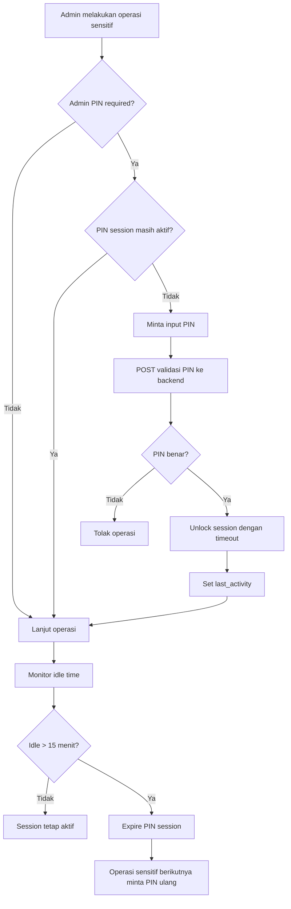

# Flowchart 16 — Admin PIN Session

## Scope

Flow verifikasi admin PIN untuk operasi sensitif, session unlock, timeout, dan batas keamanan penyimpanan PIN.

## Logic Notes

- Idle timeout default misalnya 15 menit.
- PIN tidak boleh disimpan di `localStorage`.
- Validasi PIN harus lewat backend.
- Jika perlu menyimpan session unlock di frontend, simpan hanya token/session state non-secret dengan expiry pendek.
- Operasi sensitif meliputi void invoice, update payment manual, restore database, perubahan license, dan operasi lain sesuai rule.
- Semua percobaan gagal dan sukses untuk operasi sensitif idealnya masuk audit log tanpa menyimpan nilai PIN.
