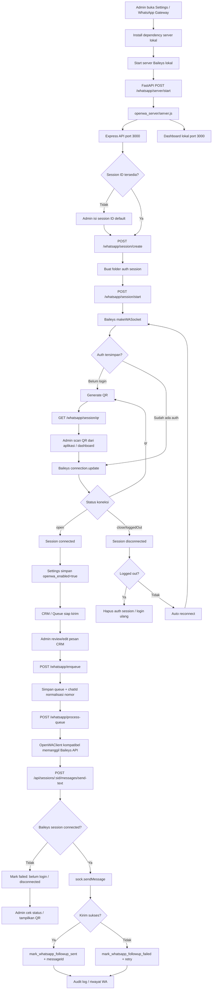

# Flowchart 17 — WhatsApp Baileys Gateway

## Scope

Alur WhatsApp Gateway lokal berbasis Baileys untuk login QR, penyimpanan session, sinkronisasi otomatis, pengiriman pesan CRM, queue follow-up, dan audit hasil kirim.

> Catatan penamaan: key konfigurasi lama masih memakai `openwa_*` agar kompatibel dengan setting dan endpoint yang sudah ada, tetapi engine lokal yang dipakai adalah Baileys (`@whiskeysockets/baileys`).

## Endpoint Aktif

- `GET /whatsapp/server/status` — cek API dan dashboard Node.js di port 3000.
- `POST /whatsapp/server/install` — install dependency `openwa_server`.
- `POST /whatsapp/server/start` — start server lokal Baileys.
- `POST /whatsapp/session/create` — siapkan session auth.
- `POST /whatsapp/session/start` — mulai koneksi Baileys dan generate QR bila belum login.
- `GET /whatsapp/session/qr` — ambil QR login.
- `GET /whatsapp/session/status` — cek status session.
- `POST /whatsapp/send-test` — kirim pesan test.
- `POST /whatsapp/enqueue` — masukkan pesan CRM/follow-up ke queue.
- `POST /whatsapp/process-queue` — proses queue via Baileys.

## Rule Implementasi

- Tidak membuka `web.whatsapp.com` untuk mode otomatis.
- Login tetap wajib melalui QR Baileys.
- Auth session tersimpan di `openwa_server/data/sessions/<session_id>/`.
- Jika session masih valid, Baileys otomatis reconnect tanpa scan QR ulang.
- Jika WhatsApp logout dari HP / device dicabut, status menjadi disconnected dan admin harus login ulang.
- CRM tetap harus meminta admin review/edit pesan sebelum kirim.
- Rate limit queue mengikuti `openwa_rate_limit_per_run`.
- Semua kegagalan kirim masuk retry/failed queue, bukan diam-diam dianggap sukses.
- Fallback `wa.me` hanya digunakan bila gateway Baileys belum aktif atau gagal, bukan alur utama.

## Status Session Baileys

- `idle` — session dibuat tetapi belum start.
- `connecting` — Baileys sedang menghubungkan.
- `qr` — QR login tersedia.
- `connected` — siap kirim pesan.
- `disconnected` — koneksi putus dan menunggu reconnect/login ulang.
- `logged_out` — session tidak valid, auth perlu dihapus/login ulang.

## Struktur Data Runtime

- Login WhatsApp memakai scan QR Baileys. Tidak ada API key untuk gateway lokal.
- `openwa_server/data/sessions/<session_id>/` — credential Baileys.
- `openwa_server/data/sessions/<session_id>/state.json` — status ringan dashboard/API.

## Checklist QA

1. Start server lokal tanpa membuka browser WhatsApp Web.
2. Buat session dan tampilkan QR di aplikasi.
3. Scan QR, status berubah menjadi `connected`.
4. Restart server, session reconnect otomatis tanpa QR baru.
5. Kirim pesan test ke nomor sendiri.
6. Kirim pesan CRM via queue.
7. Matikan koneksi/logout WhatsApp, queue gagal dengan error jelas.
8. Login ulang dan queue bisa diproses kembali.
